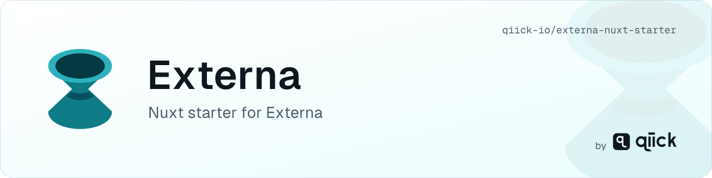

<p align="center">
  <picture>
    <source media="(prefers-color-scheme: dark)" srcset=".github/assets/header-dark.svg">
    <source media="(prefers-color-scheme: light)" srcset=".github/assets/header-light.svg">
    
  </picture>
</p>

# Externa Nuxt starter

Minimal **Nuxt 4** frontend that lists and shows collection items from the Externa [Public CMS API](https://docs.qiick.io/externa/public-cms-api).

Not a marketing theme. No Kitchen Sink. Server-side fetches only — the API key never reaches the browser (`runtimeConfig` private + `/api/*` handlers).

## Prerequisites

- Node.js 22.22.3+ (22.x), 24.15.0+ (24.x), or 26+ — same range as Nuxt 4.6. Node 24 is recommended (`.nvmrc`). Node 23 and 25 are not supported.
- A running Externa install (fresh installs need no seeded collection)

## Setup

```bash
git clone https://github.com/qiick-io/externa-nuxt-starter.git
cd externa-nuxt-starter
cp .env.example .env
npm install
npm run dev
```

Open [http://localhost:3003](http://localhost:3003).

### Environment

| Variable | Required | Notes |
|----------|----------|-------|
| `EXTERNA_API_URL` | yes | Origin only, e.g. `http://externa-core.test` (no trailing slash) |
| `EXTERNA_API_KEY` | no | `ek_…` Bearer secret. Omit to use the `public` role. Prefer a key scoped to the starter's collections with `read_only` enabled (core 1.3.0+) — see [API abuse controls](https://docs.qiick.io/externa/api-abuse-controls#api-key-scopes) |
| `EXTERNA_COLLECTION` | no | Collection slug. **Leave empty** to auto-discover the first readable collection via `GET /api/v1/collections` |

Grant **Read** on at least one collection under Roles → Collection access ([docs](https://docs.qiick.io/externa/public-cms-api#quick-start-typical-website-read)).

With an empty `EXTERNA_COLLECTION` and no readable collections, the home page shows a setup panel and pings always-public `GET /api/v1/openapi.json` to confirm the API is reachable.

## Routes

| Path | Source |
|------|--------|
| `/` | server `/api/home` → resolve collection → `GET /api/v1/collections/{slug}/items` |
| `/items/[id]` | server `/api/items/:id` → `GET /api/v1/collections/{slug}/items/{id}` |

## Layout

Nuxt 4 keeps the Vue app in `app/` and the repo root for everything else:

| Path | Role |
|------|------|
| `app/` | `app.vue`, `pages/`, `components/`, `assets/`. The `~` alias points here. |
| `server/` | Nitro routes and the Externa client. The API key stays here. |
| `shared/` | Types used by `app/` and `server/`. Import them with `#shared/…`. |

Server routes use h3 v1 (`defineEventHandler`, `getQuery`, `getRouterParam` from `h3`). Nuxt 4.6 / Nitro 2 still ship h3 1.15; do not hoist h3 2 — it breaks `getQuery` (see changelog 1.1.1).

Typed helpers live in `server/utils/externa/` (client, collections, openapi). Shared types in `shared/types/`.

## GraphQL (optional)

Same auth and Collection access apply at `/api/graphql`. This starter uses REST only; see [GraphQL](https://docs.qiick.io/externa/graphql) if you prefer a query document.

## Docs

- Guide: [Headless starter](https://docs.qiick.io/externa/headless-starter)
- [Public CMS API](https://docs.qiick.io/externa/public-cms-api) · [Client types / OpenAPI](https://docs.qiick.io/externa/public-cms-api-types) · [Bruno collection](https://github.com/qiick-io/externa-bruno)
- Conventions: [externa-core `docs/starters.md`](https://github.com/qiick-io/externa-core/blob/develop/docs/starters.md)

## Branches

| Branch | Role |
|--------|------|
| `develop` | Integration branch — open feature PRs here |
| `main` | Stable releases — merge via `release:` PRs from `develop` |

Default clone branch stays `main`. Day-to-day work targets `develop`.

## Conventions

Official Externa starters share naming, env vars, TypeScript, CI, and update cadence — see [externa-core `docs/starters.md`](https://github.com/qiick-io/externa-core/blob/develop/docs/starters.md).

## License

MIT (same as Externa Core).

## Code of Conduct

Please read our [Code of Conduct](CODE_OF_CONDUCT.md).
